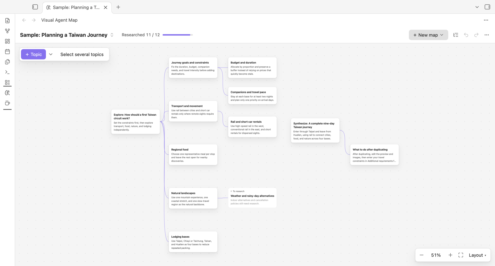

# Visual Agent Map

[English](#english) · [繁體中文](#繁體中文)

## English

### Explore big questions with visual AI research in Obsidian

**Start with a question. See the pieces. Follow the ideas worth exploring.** Build a visual research map, let AIM investigate a question, or talk through a new idea in Coffee Tables. Keep what you learn in editable Markdown notes.

[**Get started**](#get-started) · [See the 0.18.0 release](https://github.com/kevcltsai/visual-agent-map/releases/tag/0.18.0) · [Installation guide](INSTALL.md)

### Take a look

*Example visual map; this image does not show every guided research control.*

### Three ways to explore

- **Visual maps.** Break a question into topics, research a branch with AI, and review suggestions before adding them. Let AI draft a multi-level outline or suggest what to strengthen or cut, paste a heading outline, and research several topics in the background. Content templates choose which sections a research note has; writing tones choose how it reads. Manual mapping needs no AI.
- **AIM — Adaptive Inquiry Map.** Work from your question and background toward a document with supporting sources. Follow the research in the map, build on useful earlier findings, and resume unfinished work when a step fails.
- **Coffee Tables.** Bring an unfinished idea to simulated AI guests. Add `.txt` / `.md` background, choose a conversation style, invite guests with a question, and revisit observer insights and conversation segments.

Coffee Tables guests are simulated, not real experts; their conversations are not automatically fact-checked.

### Get started

1. In **Obsidian Desktop → Settings → Community plugins → Browse**, find **Visual Agent Map**, then install and enable it. Requires Obsidian **1.13.7+**.
2. Try the built-in sample or create a visual map. For AI features, install and sign in to [Codex CLI](https://developers.openai.com/codex/cli/) or [Claude Code](https://docs.anthropic.com/en/docs/claude-code/overview), then check the CLI in VAM settings.
3. Choose **＋ New map → Create Adaptive Inquiry Map (AIM)** to try AIM. Enter your question and background, answer the questions that matter, and open the connected notes to inspect research and the final document.

For detailed setup, manual installation, and troubleshooting, see [INSTALL.md](INSTALL.md).

### Your notes and privacy

Maps, research reports, Coffee Tables conversations, and observer notes are readable Markdown in your vault. You can edit and keep them outside VAM.

AI actions for selected Markdown text produce editable drafts. You explicitly accept a draft before it changes a note. **Translate image** writes a translated copy into the note once you choose **Replace image** or **Add new image**; it requires Codex, sends the image data when you run it, and keeps the original image file. To stop the automatic selection button and image button, turn off **Show “Use AI on selection” automatically** in settings; the **Use AI on selection** command still works.

VAM has no telemetry and does not store API keys. AI tasks send relevant content, including research context, selected background files, or guest profiles, through your local CLI to OpenAI or Anthropic. Your provider allowance or charges may apply. AI request/reply logging is off by default; enabled logs may contain private note content.

Local access and permissions

The CLI inherits Obsidian's OS permissions; read-only or tool restrictions are not an OS sandbox. VAM may read vault Markdown paths to find its workspace and probe CLI paths outside the vault. Optional AI exchange logs and temporary files are stored in plugin data. Copy actions write requested text to the clipboard; VAM does not read clipboard contents or install/update your CLI.

### Current limitations

Desktop only; macOS with Obsidian 1.14.4 is the verified environment for AIM. Windows and Linux remain unverified.

AIM searches the web and provides source links, but finding a source does not prove its claims are true. AI judgments, unavailable sources, and account limits can leave research incomplete. Check important claims against the original sources.

Researching several topics at once uses more of your provider allowance, and a busy model can make some topics fail; retry them, for example with another model. A content template that requires an item count can send one extra AI request to fix the count.

Images found by AI web search may not be free to reuse; check each source page. Outline search covers titles in the current map, not full text. Map undo/redo is temporary and clears when you switch maps or close the view.

Coffee Tables stores what it needs to continue a conversation in the hidden `Coffee Tables/.sessions` folder. Obsidian Sync skips hidden folders, so on other devices you can read synced conversations but not continue them; continue them on the device where they started.

### Research inspiration

AIM's planning, search, and synthesis approach is inspired by [the original research project](https://github.com/InternLM/MindSearch) and [Chen et al. (2024)](https://arxiv.org/abs/2407.20183). VAM independently implements and adapts this workflow for Obsidian; this attribution does not imply affiliation or endorsement.

### Help and license

[Report an issue](https://github.com/kevcltsai/visual-agent-map/issues) · [Changelog](CHANGELOG.md) · [AGPL-3.0-only](LICENSE)

Copyright © 2026 Kevin Tsai

---

## 繁體中文

### 在 Obsidian，用視覺化 AI 地圖探索問題

**從一個問題出發，看見各個部分，再追你想探索的線索。** 建立視覺化研究地圖、讓 AIM 深入查證問題，或到 Coffee Tables 聊出新角度；想留下的發現都能存成可編輯的 Markdown 筆記。

[**開始使用**](#開始使用) · [查看 0.18.0 正式版](https://github.com/kevcltsai/visual-agent-map/releases/tag/0.18.0) · [安裝指南](INSTALL.md)

### 看看畫面

*視覺化地圖範例；圖片未展示所有引導式研究操作。*

### 三種探索方式

- **視覺化地圖。** 把問題拆成議題，用 AI 深入一個分支；先查看建議，再決定是否加入。也能讓 AI 草擬多層大綱、建議哪裡該加強或刪減，貼上標題大綱，並在背景同時研究多個議題。內容模板決定研究筆記有哪些段落，寫作語氣決定它讀起來的風格。手動繪圖不需要 AI。
- **AIM — Adaptive Inquiry Map。** 從你的問題與背景出發，逐步形成附有來源的文件。在地圖中追蹤研究、沿用有用的既有發現，遇到失敗時接續未完成的工作。
- **Coffee Tables。** 把未成形的想法帶來，與模擬 AI 來賓對談。加入 `.txt`／`.md` 背景、選擇對談風格、透過追問邀請來賓，並回看觀察者洞見與對話段落。

Coffee Tables 來賓是模擬角色，不是真實專家；對談內容不會自動查證。

### 開始使用

1. 到 **Obsidian 桌面版 → 設定 → 第三方外掛 → 瀏覽** 搜尋 **Visual Agent Map**，安裝並啟用。需要 Obsidian **1.13.7+**。
2. 先試內建範例，或建立自己的視覺化地圖。使用 AI 功能前，安裝並登入 [Codex CLI](https://developers.openai.com/codex/cli/) 或 [Claude Code](https://docs.anthropic.com/en/docs/claude-code/overview)，再到 VAM 設定檢查 CLI。
3. 選擇「**＋ 新增地圖 → 建立 Adaptive Inquiry Map（AIM）**」體驗 AIM。輸入問題與背景，回答重要的條件問題，再開啟相連的筆記查看研究與最終文件。

詳細設定、手動安裝與問題排除，請見 [INSTALL.md](INSTALL.md)。

### 你的筆記與隱私

地圖、研究報告、Coffee Tables 對談與觀察者筆記，都是 Vault 裡可閱讀的 Markdown。你可以編輯它們，也可以離開 VAM 繼續使用。

選取 Markdown 文字的 AI 操作會產生可編輯草稿，你必須明確接受草稿，才會改動筆記。「生成翻譯圖片」在你選擇「取代原圖」或「新增一張」後，會把翻譯版圖片寫入筆記；它需要 Codex，執行時才傳送圖片資料，原始圖片檔保持不變。若不想在選取文字或點選圖片時自動出現 AI 按鈕，可在設定關閉「自動顯示『用 AI 處理選取文字』」；「用 AI 處理選取文字」命令仍可使用。

VAM 不含遙測，也不儲存 API key。AI 任務會透過本機 CLI 將相關內容，包括研究脈絡、選取的背景檔或來賓設定，傳送至 OpenAI 或 Anthropic，可能使用帳號額度或產生費用。AI 請求／回覆紀錄預設關閉；啟用後的紀錄可能包含私人筆記。

本機存取與權限

CLI 繼承 Obsidian 的作業系統權限；唯讀或工具限制不等於 OS sandbox。VAM 可能讀取 Vault 的 Markdown 路徑來尋找工作區，也會探測 Vault 外的 CLI 路徑。選用的 AI 往返紀錄與暫存檔會保存在外掛資料中。複製操作只將指定文字寫入剪貼簿；VAM 不讀取剪貼簿內容，也不會自行安裝或更新 CLI。

### 目前限制

僅支援桌面版；AIM 已驗證環境為 macOS 與 Obsidian 1.14.4。Windows 與 Linux 尚未驗證。

AIM 會搜尋網路並提供來源連結，但找到來源不代表內容已證實。AI 判斷、無法存取的來源與帳號額度，都可能讓研究未能完成。重要主張請回到原始來源核對。

同時研究多個議題會用掉較多額度，模型忙碌時部分議題可能失敗，可以重試，例如換一個模型。內容模板設定了項目數時，可能多送一次 AI 請求來修正數量。

AI 從網路找到的圖片不一定能自由使用，請查看各自的來源頁。大綱只搜尋目前地圖的議題名稱，不搜尋全文。地圖的復原／重做是暫存紀錄，切換地圖或關閉視圖後會清除。

Coffee Tables 把接續對談所需的資料存在隱藏資料夾 `Coffee Tables/.sessions`。Obsidian Sync 不同步隱藏資料夾，因此在其他裝置上可以閱讀同步過去的對談，但無法接著聊；請回到開始對談的裝置繼續。

### 研究流程參考

AIM 的研究規劃、搜尋與整合方式參考 [原研究專案](https://github.com/InternLM/MindSearch) 與 [Chen 等人（2024）的論文](https://arxiv.org/abs/2407.20183)。VAM 為 Obsidian 獨立實作與調整此流程；此標註不代表隸屬或獲得原專案背書。

### 支援與授權

[回報問題](https://github.com/kevcltsai/visual-agent-map/issues) · [版本紀錄](CHANGELOG.md) · [AGPL-3.0-only](LICENSE)

Copyright © 2026 Kevin Tsai
