# Mermaid 圖型範例

Every block is a diagram type the sanitizer must keep as `mermaid`.

### flowchart TD

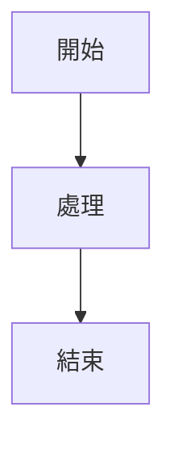

### graph LR

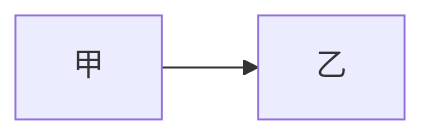

### sequenceDiagram

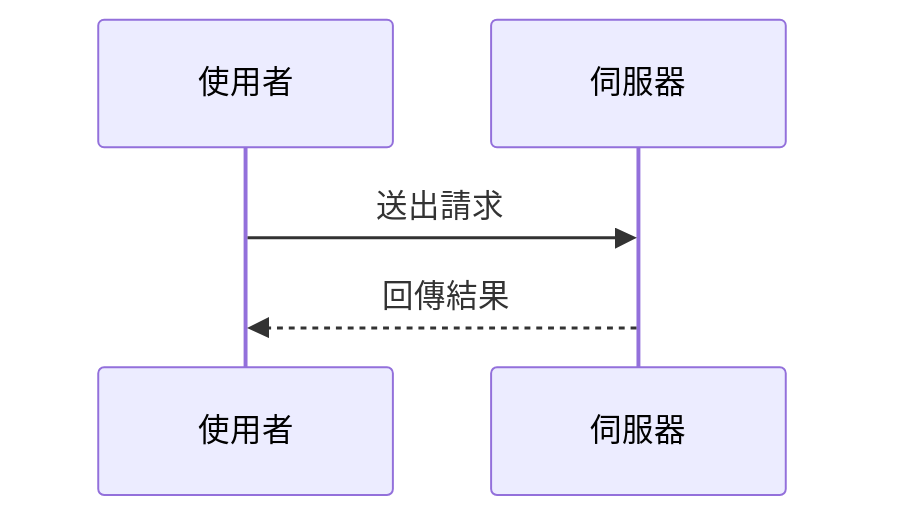

### classDiagram

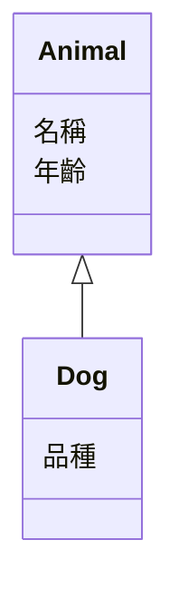

### classDiagram-v2

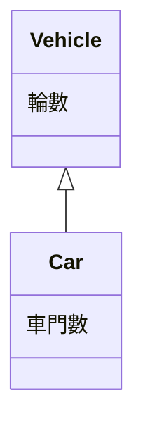

### stateDiagram

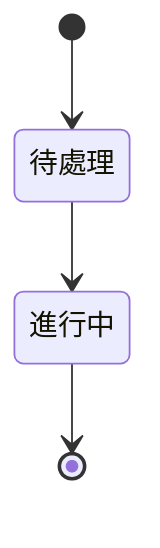

### stateDiagram-v2

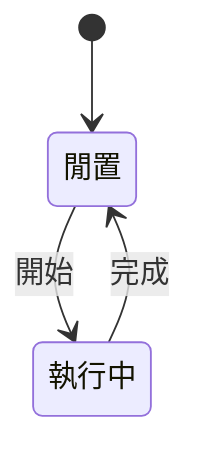

### erDiagram

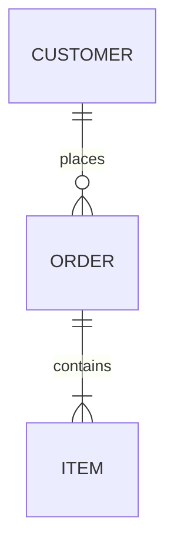

### journey

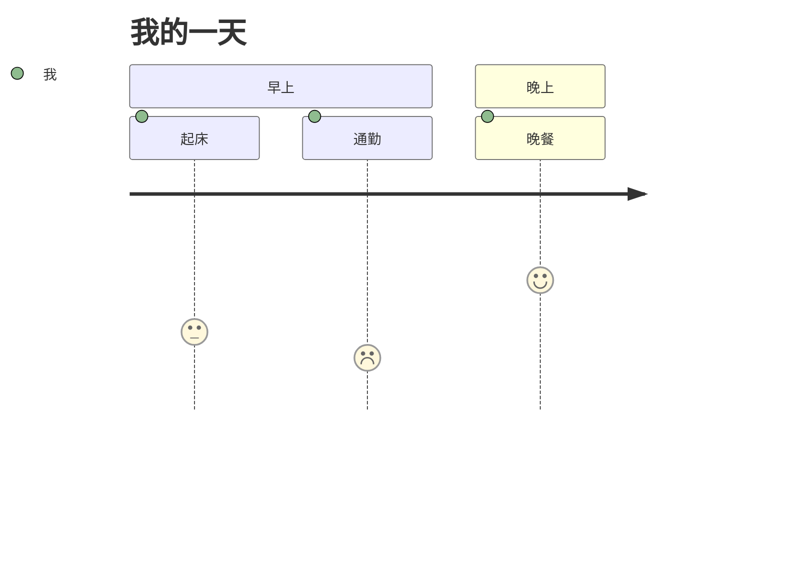

### gantt

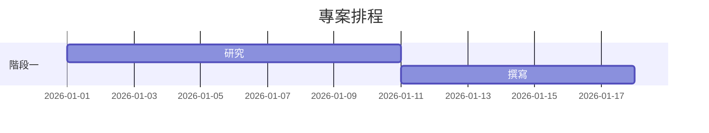

### pie

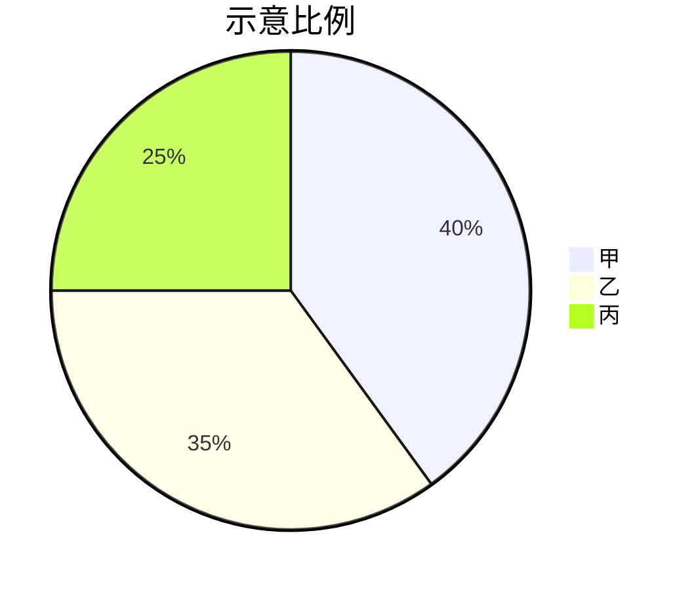

### quadrantChart

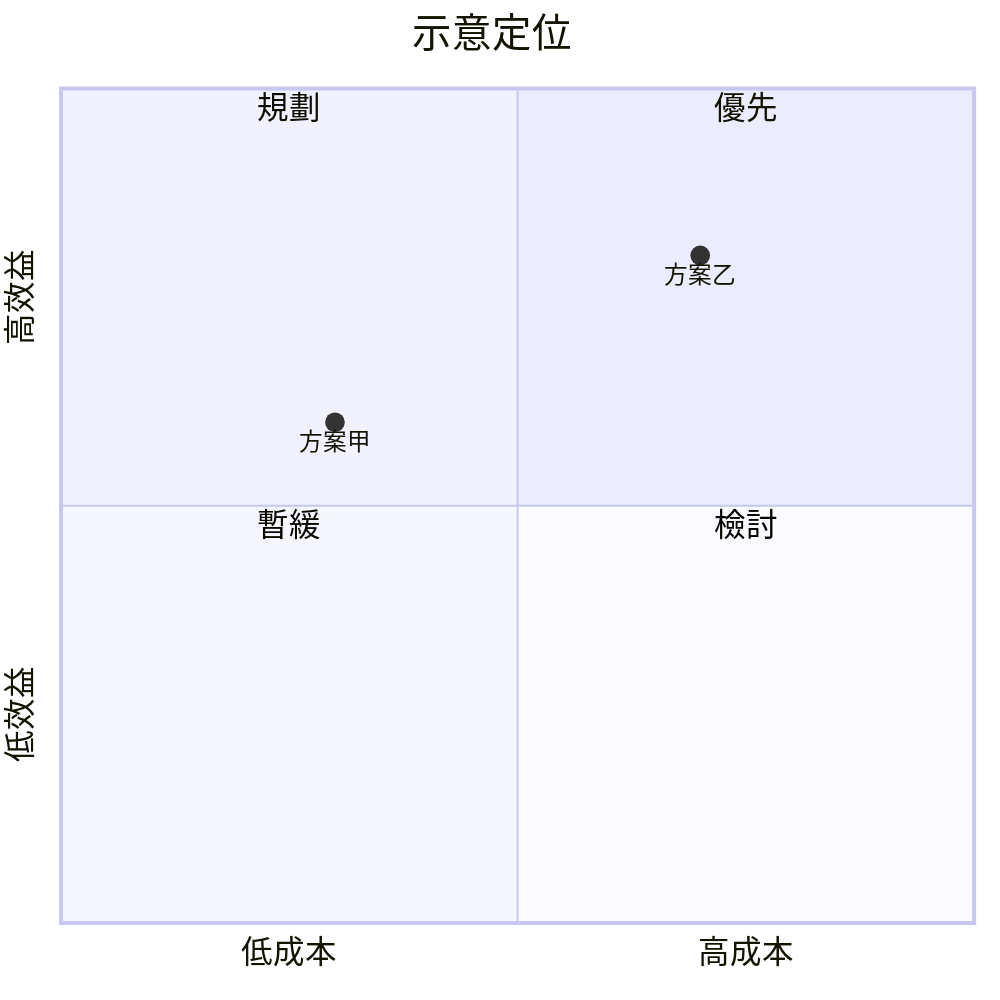

### requirementDiagram

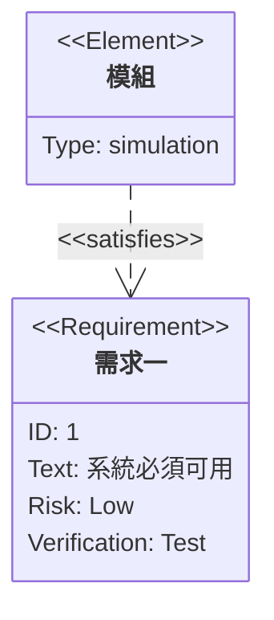

### gitGraph

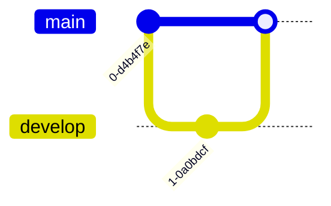

### C4Context

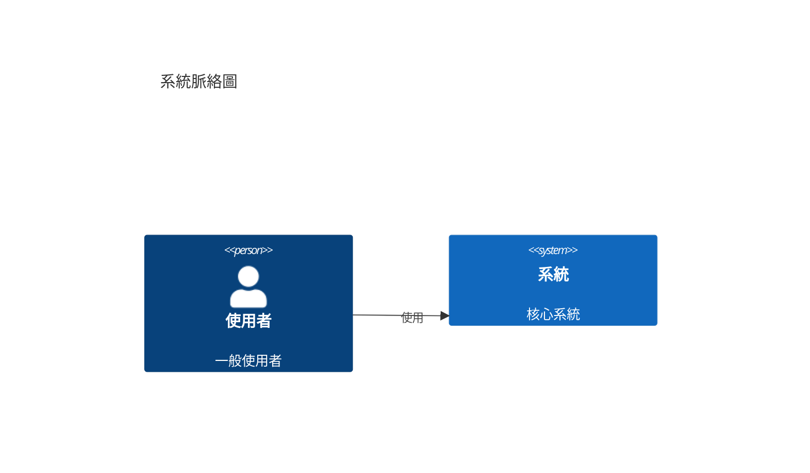

### C4Container

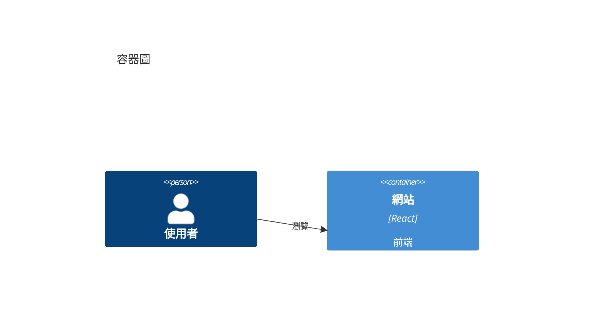

### C4Component

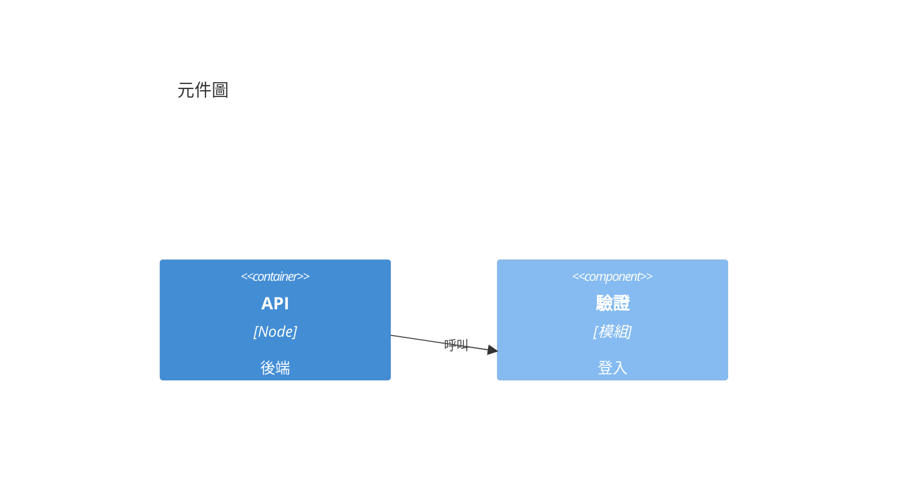

### C4Dynamic

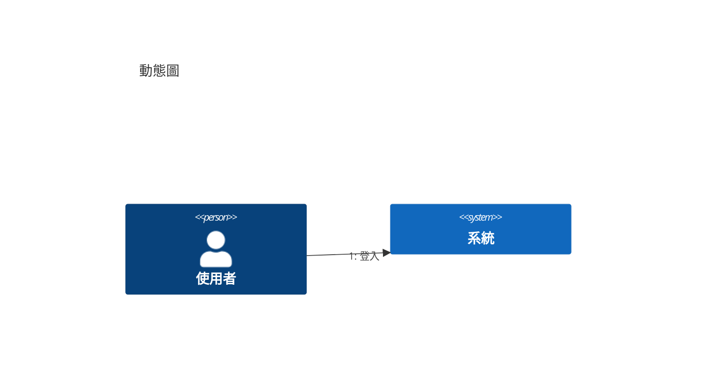

### C4Deployment

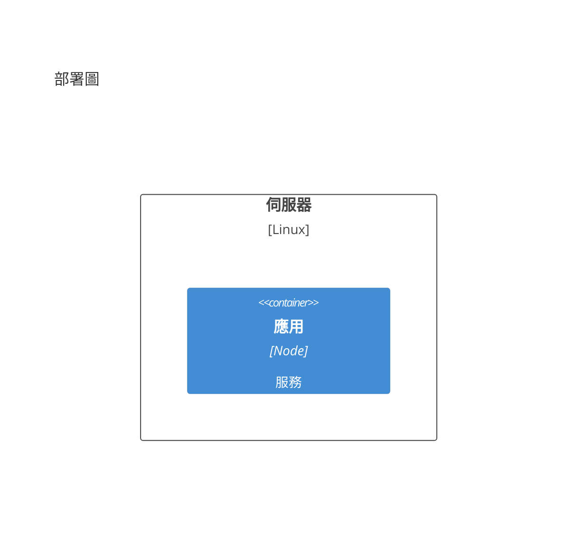

### mindmap

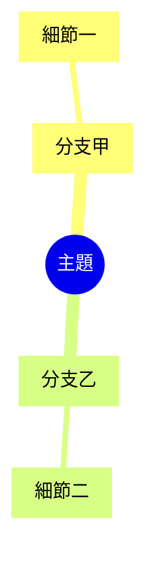

### timeline

```mermaid
timeline
  title 發展歷程
  2020 : 起步
  2022 : 成長
  2024 : 成熟
```

### sankey-beta

(mermaid 11.13.0 sankey labels are ASCII only; CJK labels fail to parse.)

```mermaid
sankey-beta

SourceA,Result1,30
SourceA,Result2,20
SourceB,Result1,10
```

### xychart-beta

```mermaid
xychart-beta
  title "示意趨勢"
  x-axis ["一月", "二月", "三月"]
  y-axis "數量" 0 --> 100
  bar [20, 50, 80]
  line [20, 50, 80]
```

### block-beta

```mermaid
block-beta
  columns 2
  a["甲"] b["乙"]
  c["丙"] d["丁"]
```

### packet-beta

```mermaid
packet-beta
  0-15: "來源埠"
  16-31: "目的埠"
```

### kanban

```mermaid
kanban
  待辦
    t1[撰寫文件]
  進行中
    t2[審查程式]
```

### architecture-beta

```mermaid
architecture-beta
  group api(cloud)["API"]
  service db(database)["資料庫"] in api
  service srv(server)["伺服器"] in api
  db:L -- R:srv
```

### radar-beta

```mermaid
radar-beta
  axis a["速度"], b["品質"], c["成本"]
  curve s1["方案甲"]{4, 3, 2}
  curve s2["方案乙"]{2, 4, 5}
```

### treemap-beta

```mermaid
treemap-beta
"根"
    "分類甲"
        "項目一": 10
        "項目二": 20
    "分類乙"
        "項目三": 15
```

### venn-beta

```mermaid
venn-beta
  set A["甲"]
  set B["乙"]
  union A,B["共通"]
```

### ishikawa

```mermaid
ishikawa
  魚骨主題
    原因甲
      細項一
    原因乙
      細項二
```

### ishikawa-beta

```mermaid
ishikawa-beta
  魚骨主題
    原因甲
      細項一
    原因乙
      細項二
```
